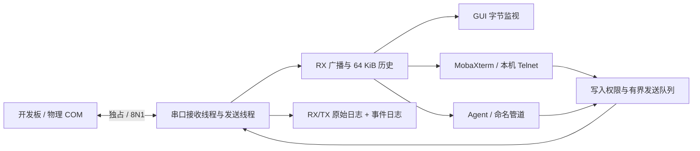

# 串口代理设计与技术决策

## 需求解读

原始要求来自 `docs/原始需求.txt`：MobaXterm 与 Codex 频繁争用同一物理串口，希望双方同时参与串口调试，并由用户承担同时写入的冲突风险。Windows 通常不允许多个进程同时打开同一个串口，因此需要一个长期持有物理口的代理，再接入多个客户端。

“同时读”定义为每个在线客户端收到相同顺序的物理 RX 字节。“同时写”定义为多个客户端可以提交发送请求，代理按入队顺序发送整个请求块，避免一个 Win32 写调用与另一个并发；不保证来自不同客户端的完整 shell 命令、请求响应事务互不干扰。

用户本轮要求：在新的项目文件夹保存实现、技术栈和设计思路；只做到编译结束，不做动态验证。没有运行任何目标程序、访问物理串口、启动监听、安装驱动或更改系统网络配置。本轮不使用 REA。

## 技术栈与范围

| 决策 | 选择与理由 |
|---|---|
| 实现语言 | C++20：直接使用 Win32 串口与取消 I/O，工具链本机已有 |
| GUI | 原生 Win32：配置、会话授权、字节监视，避免 Qt/.NET 部署依赖 |
| 构建 | CMake + Visual Studio 2022 x64，/W4 /WX /permissive- /utf-8，静态 CRT |
| 物理口 | 独占 CreateFile + overlapped ReadFile/WriteFile，首版 8N1、无流控 |
| MobaXterm 接入 | 回环 Telnet，默认 127.0.0.1:7000，可关闭 |
| Agent 接入 | 双向命名管道，默认 `\\.\pipe\SerialBroker.COM3`，随 COM 名变化 |
| 数据协议 | 固定长度头 + 有界载荷；发送请求带 request ID，返回实际驱动写入确认 |
| 依赖 | Windows SDK、Winsock2、系统安全 API；无需第三方库或驱动 |

不选择虚拟 COM 驱动，是因为这会引入内核组件、签名、安装权限和系统配置变更，不适合本轮只编译的首版。代价是只能接受 COM 口的软件还不能直接使用该代理。MobaXterm 有 Telnet 会话入口，Agent 可直接使用配套 CLI，所以先覆盖主要工作流。

首版不是 RFC2217 服务，不允许客户端更改波特率、DTR/RTS 或其它物理参数；所有客户端共享 GUI 启动时选定的参数。不是 USB 固件下载专用代理；对自动复位、切波特率、BREAK、9 位串口或严格时序的协议不作兼容承诺。

## 数据路径

接收线程读取至多 4096 字节，先记录日志与监视事件，再广播到各客户端。历史缓存只保存 RX；新客户端历史入队与实时广播共用 fanout 锁，避免接入时出现重复或空洞。历史和实时在同一数据流中传输，不标记终端历史边界，CLI 不应将新连接后的全部输出都视作某次命令响应。

TX 不向 RX 流注入，防止改变设备原始输出；GUI 中 `[TX]` 监视项和前面的 `TX client=...` 事件提供可观察性。开发板自身有回显时，MobaXterm 可以正常看到命令；无回显时请看代理 GUI。后续可增加独立 TX 订阅通道，而不是污染 RX。

## 写入权限

| 策略 | 行为 |
|---|---|
| 全部只读 | 手动选择后，所有 TX 和写入权申请被拒绝 |
| 单写入者 | 首个发送数据或通过 CLI 申请的客户端取得空闲写入权，其它写入者被拒绝；断开或释放后可由下一位取得 |
| 共享写入 | 默认；所有已连接客户端可写；物理串口仍由唯一 TX 线程顺序写入 |

GUI 只通过写入策略下拉框控制权限，已移除授予/撤销授权按钮。CLI 的 `send` 和 `interactive` 明确发送 acquire；`watch` 从不申请写入权。Telnet 不解析控制命令，输入字节只代表串口 TX；默认共享模式下直接可写，单写入者模式下首个有效 TX 可自动取得空闲写入权。自动取得写入权与入队在同一个 gate 临界区完成；无效或队列已满的请求不占用写入权。空闲时不自动超时抢占，避免正在等待长命令的写入者被另一客户端接管。要重新选择单写入者，可先切只读再切回单写入者，并让目标会话首先发送。

下拉框处理已改为确认选择后应用，收起时的键盘选择也可直接应用。打开列表期间，定时刷新不调用 CB_SETCURSEL，焦点/展开等通知也不触发旧策略回填；取消选择后恢复真实策略。重复确认同一策略不再递增 generation、撤销租约或重复记日志。此前这些通知中的无条件界面刷新会把正在选择的条目设回旧值，是下拉框回跳的代码原因。

策略切换、转移或释放单写入权时递增 generation。每个排队请求携带入队时的 generation，TX 线程取出时重新检查 generation、权限和会话是否仍在线。切换策略、撤销权限或断开原写入者会使旧的排队请求失效。新策略下重新提交的请求可正常入队。

请求通过发送前检查后视作 in-flight。撤销只能阻止尚未进入发送阶段的块，不能收回已通过检查、已进入 Windows I/O 或驱动队列的字节；最多一个正在发送的块可能继续完成。需要严格设备级停止时必须在上层协议或硬件层设计中断，不能依赖 GUI 撤销按钮。

CLI 单次发送最多 4096 字节，作为一个调度块。Telnet 的网络分片可以包含单个按键、若干按键或粘贴片段，共享模式不提供整行原子性。FIFO 只约束请求实际获得队列锁后的顺序，不推断用户操作的绝对先后顺序。共享模式没有事务锁、命令合并、板端去重或自动重试。

## 并发与资源边界

| 资源 | 限制 / 处理方式 |
|---|---|
| 在线客户端 | 总计最多 32 个，包括 Telnet 和命名管道；新接入时回收旧会话 |
| 每会话线程 | 独立接收和发送线程，不在串口广播中进行阻塞网络写入 |
| 每会话发送缓冲 | 256 KiB 或 1024 个包；超限断开该客户端 |
| 单次网络写入 | 总截止时间约 3 秒；慢接收者会断开 |
| 共享 TX 队列 | 64 KiB 或 256 个请求；超限明确拒绝，避免小包无限占用内存 |
| 单次物理写入 | 4096 字节以内；截止时间为该波特率下的 8N1 理论线速时间 + 3 秒；失败停止整个代理以保留故障边界 |
| GUI 待处理事件 | 512 KiB 或 2048 项；超限只丢监视显示项并报告数量 |
| GUI 文本 | 有界裁剪到约 200,000 字符以内；每次批量显示也有上限 |
| RX 历史 | 最近 64 KiB，先进先出 |
| 日志 | RX / TX 各 128 MiB，事件日志 8 MiB；任一到限后停止本次会话日志 |

锁按职责区分：gate 管权限和 TX 队列，clients_mutex 管在线会话容器，fanout 管历史与加入广播的顺序，log_mutex 管日志。调用会话 stop/enqueue 的路径不持有 gate；stop 回调可安全撤销租约。回收会话时先从容器取出，再在锁外 join。GUI 从有界队列取监视事件，只在主线程修改控件。

低波特率的大块数据需要更久发送，串口截止时间随理论线速计算，避免把 9600 波特率下 4096 字节的正常传输误判为固定 3 秒超时。CLI 的确认等待时间仍需用户设置得足够长；例如低速大块数据应提高 `--timeout` 或拆分发送。停止标记按短等待周期检查，不必等完整线速超时后才取消。

物理串口和管道用 overlapped I/O。停止时取消 I/O，并等待完成之后才释放 OVERLAPPED、事件与缓冲区。超时取消和成功完成竞态中保留成功返回的数据。TCP 用非阻塞 socket 和短时间 WSAPoll。启动/停止在 GUI 工作线程中执行，窗口定时器回收工作线程，避免在按钮回调中等待串口 I/O。

首版日志同步按块刷新。如果磁盘或文件系统严重变慢，串口接收线程可能被写盘拖慢，驱动接收缓冲最终仍可能溢出。它不是具备端到端背压保证的无损采集器；后续可将日志搬到独立有界磁盘队列，并增加明确的日志丢弃与串口溢出计数。

## 启动、停止和故障

启动顺序：验证配置 → 用 FIRST_PIPE_INSTANCE 保留管道名 → 可选地独占绑定 TCP 端点 → 独占物理 COM → 配置 DCB/超时 → 建立日志目录 → 默认使用共享写入策略 → 启动工作线程。任一步失败都关闭已取得的资源。首先保留端点可尽量在重复启动时避免触碰硬件。

停止时设置停止标记、唤醒发送线程、取消串口 I/O、等待监听线程退出、停止全部客户端、回收 RX/TX 与会话线程、释放句柄、清空未发送队列并关闭日志。停止不等待物理输出队列排空，也不自动重发待发送块。

串口读写异常、发送超时或监听器失败时停止代理。GUI 定时器随后执行完整清理，释放资源。拔插之后由用户重新启动；不自动打开新出现的同名 COM，避免向另一设备意外发送。启动串口本身及 DTR/RTS 的驱动行为可能使开发板复位，默认关闭这些信号不能保证所有硬件无复位。

`written(request,count)` 仅表示 WriteFile 完成。它不等价于所有比特已经从 UART 发出，也不表示板端命令执行或响应完成；不调用可能无限阻塞的 FlushFileBuffers 来伪造更强确认。发送失败或 ACK 丢失后，部分或全部数据可能已发出，不自动重试。失败块可能包含已发出的前缀，这部分不进入 tx.bin，事件明确记录 partial TX possible。

## 接入与安全边界

命名管道 DACL 只允许当前用户 SID 与 SYSTEM，拒绝远程管道客户端。CLI 以 Identification 级别连接，避免向假冒管道服务端授予可模拟权限。它仍不是针对同一 Windows 用户恶意程序的安全边界；本地同用户程序能申请写入、消耗会话名额或查看日志。

Telnet 只绑定 IPv4 回环地址，使用 SO_EXCLUSIVEADDRUSE 避免端口复用，无网络认证。回环 TCP 上的其它本机用户/进程也可能连接；需要限定用户时关闭 Telnet，仅启用命名管道。只读策略不能阻止本机客户端读取设备输出。

Telnet 支持 IAC 转义、DO/DONT/WILL/WONT 协商和子协商过滤，提供 BINARY、ECHO、SUPPRESS-GO-AHEAD 的基础字符会话行为；非二进制输入将 CR NUL 还原为 CR。输出将 0xFF 转义。没有完整 RFC854/1143 状态机、终端尺寸转发、RFC2217、BREAK 透传或通用二进制工具兼容保证；二进制数据优先使用命名管道协议。

## 后续优先级（本轮不执行）

1. 用户允许动态验证后，先做脱离真实设备的管道协议、权限转移、慢客户端和取消竞态测试，再做单个真实串口与 MobaXterm 联调。
2. 根据联调确认 DTR/RTS、电平、换行、编码和 Telnet 字符模式，补齐丢字节/设备错误计数。
3. 若仍需要不支持网络的串口工具，再单独评估已签名虚拟 COM 对的接入层，保持物理串口代理和驱动安装分离。
4. 如果工作流需要 Agent 自动等待提示符或命令结果，建立更高层终端状态/任务协议，不将底层字节流 ACK 当作命令成功。
